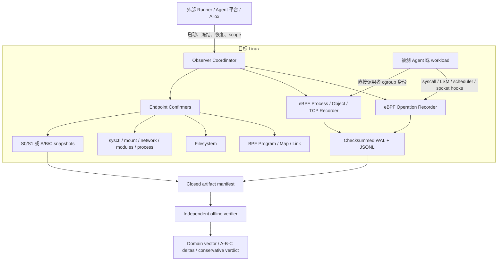

# Linux System Effects Observer 项目规格说明

> **Linux System Effects Observer（仓库名称：BPF State Observer）是面向受控 AI Agent 工作负载的 Linux/eBPF 系统效果观测与恢复一致性验证底座。它记录 Agent 进程树直接发起的系统操作，解析部分实际内核对象，并在明确范围内比较执行前、执行后及恢复后的 Linux 端点状态。**

本文描述当前代码已经实现的能力、使用方式和严格边界。文中的“完整”始终指声明的协议和显式 scope，不代表整个 Linux 内核、所有系统状态或远端系统。

## 1. 项目是做什么的

AI Agent 会创建和修改文件、启动子进程、连接网络、调整 namespace，甚至调用 BPF、mount、module、sysctl 等内核接口。只保存命令输出，无法回答这些操作实际触及了什么；只比较任务前后的文件，也无法发现瞬时操作或非文件系统影响。

Observer 将问题拆成两条互补的证据链：

1. **操作历史（operation history）**：通过 eBPF 记录指定 cgroup 中选定 syscall 的进入、返回、调用者身份和部分内核对象语义。
2. **端点状态确认（endpoint confirmation）**：在边界上采集显式范围的状态，比较执行前后或恢复前后的确定差异。

因此它可以回答：

- Agent 直接调用了哪些受支持的系统接口，调用成功还是失败；
- 受支持的操作在内核 hook 处对应哪个文件、inode、socket 或进程身份；
- 指定文件树、BPF 对象、sysctl、mount、网络配置、内核模块和进程残留是否发生了端点变化；
- 外部恢复机制运行后，声明范围内是否仍存在 A→C 残留。

Observer **不是** sandbox、通用回滚引擎、恶意特权 Agent 的安全边界，也不是“整个 Linux 内核差分器”。恢复动作由外部系统提供，Observer 负责协调、记录、比较和验证。

## 2. 解决什么问题

| Agent 实验中的问题 | Observer 提供的能力 | 能得到的结论 |
|---|---|---|
| 只知道执行了命令，不知道调用了哪些系统接口 | 按策略记录 syscall attempt/result | 得到选定接口的操作历史和返回结果 |
| `openat("/tmp/a")` 只是字符串，`write(fd)` 甚至没有路径 | BPF LSM/VFS/socket hook 提供部分对象解析 | 将部分操作关联到实际文件、inode 或 socket 身份 |
| 子进程和并发线程的来源难追踪 | cgroup 归因及 fork/exec/exit 流 | 证明选定事件发生时调用者位于注册 cgroup 范围内 |
| syscall 成功不等于最终状态真的改变 | S0/S1 端点 confirmer | 确认显式状态域的执行前后差异 |
| 回滚命令成功不等于状态已经恢复 | A/B/C 恢复协议 | 分别计算 Agent 变化、恢复动作和最终残留 |
| 单个 JSON 结果可能被删改或伪造 | checksummed WAL、闭集 manifest、独立 verifier | 重放原始证据并重新计算比较结果和 verdict |
| 全量观测可能产生过高开销 | 分层 profile、内核早期过滤、边界 confirmer | 按实验问题选择开销与覆盖范围 |

## 3. 研究对象和部署边界

研究对象是 **Agent 对目标 Linux 造成的影响**。QEMU 可以作为安全、可恢复的实验环境，但 QEMU 本身不是 Observer 的观测对象；生产接入也不强制要求 QEMU。

当前支持三种已有工作负载的部署身份：

| 模式 | Observer 能看到什么 | 当前边界 |
|---|---|---|
| `DIRECT` | 与 Observer 共享目标内核的进程树、cgroup 和选定 namespace | 已实现，并完成 privileged VM 验证 |
| `DOCKER` | 容器在同一目标内核中的 cgroup、init 进程、host-visible namespace 和 syscall | 已实现；真实 Docker + 4 个 Terminal-Bench 小任务已验证 |
| `KATA_HOST` | 目标 Linux 上的 Kata shim、QEMU、virtiofs、虚拟磁盘和网络后端 | 已实现 Host 侧发现；不进入 Kata Guest，真实 Kata runtime E2E 尚未完成 |

对于 Kata，Guest 内 syscall 发生在另一个内核中。目标 Linux 上的 Observer 只观察 Kata runtime/QEMU 及其后端对目标 Linux 的影响，不能声称看到了 Guest 内 Agent 的 syscall。

`deployment-observe` 不负责启动 Docker/Kata，也不调用容器运行时 CLI。外部 runner 必须提供可信身份，并负责在 READY、执行结束等边界冻结和恢复目标。

## 4. 核心功能

### 4.1 独立 Linux runner

`observe-effects` 不依赖 Agent 框架、Allox、Docker 或 Kata。它执行以下生命周期：

```text
创建独立 cgroup
  → 校验并加载 eBPF recorder
  → 注册 cgroup 与 run epoch
  → 采集启用域的 S0
  → 在该 cgroup 中启动 workload
  → 记录操作、对象和进程事件
  → 等待整个 cgroup 进程树退出
  → 冻结空 cgroup、排空 recorder
  → 采集启用域的 S1
  → 写入闭集 manifest
  → 独立 verify-effects 重放验证
```

该模式最适合独立实验和框架无关的 Agent 任务采集。它继承调用者凭据，本身不隔离 workload 与证据目录，因此默认威胁模型是合作型、受控工作负载。

### 4.2 通用系统效果 recorder

recorder 当前定义七个操作域：

| 操作域 | 代表性操作 |
|---|---|
| Filesystem | create/open/write/truncate/rename/unlink、目录、链接、权限、owner、xattr、fsync、mmap 写通道 |
| Network | socket/create/connect/bind/listen/accept/send、setsockopt |
| Namespace | mount/umount、pivot_root、chroot、unshare、setns、新 mount API |
| Kernel control | BPF、module、perf、ptrace、kexec、reboot、swap、ioctl、prctl 等控制面 |
| Security | credential、keyring、seccomp、quota、Landlock 等 |
| Async I/O | io_uring、userfaultfd 等已选接口 |
| I/O | write/pwrite/writev、sendfile、splice、copy_file_range 等 FD 数据路径 |

profile 是累计的事件选择策略，不是覆盖完整度声明：

| Profile | 主要用途 | 开销取向 |
|---|---|---|
| `control` | 控制面、元数据和高风险接口 | 默认，事件量最低；不含普通 write/send 数据路径 |
| `balanced` | 在 `control` 上加入 write/pwrite/writev、send 等 | 适合一般 Agent 效果收集 |
| `full` | 再加入 fsync、写方向 mmap/mprotect、setsockopt、ioctl、prctl | 事件量最高，随 workload 变化 |

`full` 不表示完整覆盖所有内核修改。compat/x32、完整 ioctl/netlink payload、`io_uring` 对象语义、`SCM_RIGHTS`、委托 daemon 和延迟 kernel worker 等仍在合同之外。

### 4.3 对象级语义

对象解析由调用者显式选择，并绑定进证据和离线验证：

| 模式 | 当前语义 |
|---|---|
| `user-input` | 仅记录 syscall 入口处的有界路径或 sockaddr 字节；不是内核最终对象 |
| `kernel-file-open-partial` | 为部分成功 open 系列解析最终 VFS 文件对象和内核路径快照 |
| `kernel-file-open-write-partial` | 在上一模式上，为部分正字节 write 系列解析实际 `struct file` |
| `kernel-object-expanded-partial` | 再覆盖选定 create/link/unlink/rename/chmod/chown/xattr、共享可写 mmap/mprotect、bind/connect/accept、TCP 状态及进程生命周期 |

当前对象身份可包含 boot ID、mount ID、device/inode、可选 inode generation、文件系统类型、socket/netns cookie、协议族和 endpoint 等。

“partial”是实质限制：create 主要识别父对象，rename 只识别源对象，xattr 缺少 mount identity；mmap/mprotect 只能证明建立了可写通道，不能证明页面后来真的变脏；非 TCP socket、`io_uring`、FD 传递和 compat ABI 仍可能是 `UNRESOLVED`。Observer 不会用 `/proc/<pid>/fd` 的事后猜测冒充事件时的内核对象身份。

### 4.4 直接调用者归因和进程生命周期

所有选定 hook 都先检查调用者是否位于注册的 cgroup 或 FD-pinned ancestor root 下。该证据可表达：

```text
DIRECT_CALLER_ESTABLISHED
```

它不能表达通用因果关系。如果 Agent 通过 D-Bus、systemd、宿主 daemon、远端 API 或内核 worker 间接触发效果，实际 syscall 不在 Agent cgroup 中，结论必须保持：

```text
CAUSAL_NOT_ESTABLISHED
```

expanded 模式单独记录 fork、成功 exec 和 exit，并使用 PID/TGID 与 task start-boottime 降低 PID 复用歧义。但当前 lifecycle schema 没有权威 S0 全任务 ledger、完整 cgroup migration 流和 `CLONE_INTO_CGROUP` enrollment 证明，因此生命周期状态最高只能是 `PARTIAL`，不能写成完整进程树证明。

### 4.5 最终状态 confirmer

状态 confirmer 只在 S0/S1 或 A/B/C 边界运行，不进入 syscall 热路径。当前实现的显式状态域如下：

| 状态域 | 当前确认范围 |
|---|---|
| BPF | Program、Map、Link 和 bpffs pin；ARRAY/HASH/PERCPU_ARRAY/PERCPU_HASH 内容可按 scope 采集 |
| Filesystem | 有界路径树的类型、device/inode、mode、owner、link count、size、mtime/ctime，以及可选内容 hash、symlink 和 xattr |
| sysctl | 显式 `/proc/sys` key allowlist |
| mounts | 一个绑定 mount namespace 的 mountinfo |
| network config | 指定 namespace 内的 address、route、rule、tc 和 nftables 配置 |
| modules | 全部或显式选择的已加载模块，以及可选可读参数 |
| process residual | 指定 cgroup-v2 子树中的残留任务 |

未启用的域是 `NOT_CONFIRMED`，不是“没有变化”。keyring 最终状态当前是 `NOT_CONFIRMED`；远端 API、数据库或服务的最终状态从本机只能是 `NOT_CONFIRMABLE`。

各域顺序采集，不构成原子的全内核快照。状态差异本身也不自动证明由 Agent 导致，必须与操作归因分开呈现。

### 4.6 A→B 执行观测

standalone `observe-effects` 和 deployment protocol v2 都支持执行前后比较：

```text
A / S0：Agent 执行前
Agent 执行 + operation history
B / S1：Agent 结束并达到空/冻结边界后
```

输出包括选定操作历史、recorder health 和已启用状态域的 A→B 差异。它可以确认“范围内存在差异”，但普通相同端点不能自动证明期间从未发生变化。

### 4.7 A→B→恢复→C 一致性验证

deployment protocol v3 已实现三次快照和外部恢复协调：

```text
目标已冻结
  → Observer 采集 A，输出 READY
  → 外部发送 AGENT_STARTED，恢复目标运行
  → Agent 执行
  → 外部冻结目标，发送 PRE_RESTORE
  → Observer 采集 B
  → Observer 直接执行配置中经 SHA-256 绑定的 recovery helper
  → Observer 输出 RESTORE_COMPLETE，并采集 C
  → 外部发送 FINISH
  → 生成三组差分、最终 verdict 和闭集 manifest
```

外部输入命令严格只有 `AGENT_STARTED`、`PRE_RESTORE` 和 `FINISH`。`RESTORE_COMPLETE` 是 Observer 在 helper 返回并重新检查环境身份后输出的状态，不是调用者发送的命令。v3 nonce 用于顺序和关联，不是签名或 HMAC 认证通道。

三组差分分别是：

| 文件 | 含义 |
|---|---|
| `agent-delta.json` | A→B：Agent 执行产生了什么 |
| `recovery-delta.json` | B→C：恢复动作撤销或新增了什么 |
| `residual-delta.json` | A→C：恢复后仍残留什么 |

对象进一步分类为 `restored`、`unrecovered`、`partially_restored`、`recovery_introduced` 和 `unresolved`。

Observer 不实现通用 Linux 回滚。helper 可以调用 Btrfs rollback 或能在 Observer 存活期间完成的实验专用恢复机制，但必须是绝对路径、内容摘要绑定的可信可执行文件；Observer 不经 shell 直接执行，并记录退出状态、超时、有限 stdout/stderr、执行前后文件身份以及目标环境身份。当前同机 protocol v3 不能协调会替换正在运行 Observer 的整机 QEMU snapshot restore。

### 4.8 证据闭包和离线验证

二进制 WAL 是主要事件证据，JSONL 是便于阅读的派生投影。每轮还记录：

- 精确策略和 scope；
- attempt/result 配对、drop、pending、drain 和 barrier health；
- workload、cgroup、boot 和 namespace 身份；
- 原始状态快照和比较结果；
- 文件大小和 SHA-256 闭集 manifest。

manifest 最后提交。离线 verifier 不直接相信现成 JSON verdict，而是检查闭集目录、重放 WAL、校验 JSONL、重新比较原始快照并重算最终 verdict。

`verified=true` 只表示证据绑定、结构和重放通过，不表示观测覆盖完整，也不表示恢复一定一致。

### 4.9 开销控制

当前实现通过以下方式控制开销：

- 未选 syscall 在入口和出口只经过 policy Map 快路径；
- 只有选中且属于注册 cgroup 的调用才建立 pending state 和发布事件；
- object hook 先检查待关联操作，再读取对象字段；
- path/sockaddr 捕获有固定上限，write buffer 不复制；
- recorder ring、用户态队列、WAL、输出和 confirmer 都有硬上限与 deadline；
- 多个 cgroup root 共享同一对 recorder，而不是每个 cgroup 重复加载；
- 昂贵的 confirmer 只在状态边界执行。

历史 Terminal-Bench 扩展域实验中，S0 平均约 50.684 ms、S1 平均约 52.641 ms，两个边界合计约 103.325 ms；其中两次 BPF Program/Map 枚举约 1.712 ms。该数字只是一次 campaign 的边界耗时观察，**不是**严格 A/B slowdown，也不是 Direct、Docker、Kata 或其他机器的统一性能保证。

## 5. 结论语义

### 5.1 普通 A→B 状态结论

| 结论 | 精确含义 |
|---|---|
| `CHANGED_WITHIN_SCOPE` | 完整快照在显式 scope 内存在确定差异；不自动建立 Agent 因果归因 |
| `UNCHANGED_WITHIN_SCOPE` | 只有状态、传输、独占 actor 和 quiescence 等闭合合同全部成立时，才能证明声明范围内未变 |
| `INCONCLUSIVE` | 没有确认差异，但证据完整性、独占性、静止性或语义不足，不能证明未变 |
| `NOT_CONFIRMED` | 该状态域没有启用 confirmer |
| `NOT_CONFIRMABLE` | 目标状态不能由当前目标 Linux 本地确认，例如远端服务状态 |

通用 `observe-effects` 和普通 deployment 运行缺少已认证的全域独占 actor/quiescence 合同，因此“两个端点相同”通常仍是 `INCONCLUSIVE`。项目中 BPF 专项的 authenticated `exclusive-vm-v1` 路径可以在其封闭模型内达到 `UNCHANGED_WITHIN_SCOPE`，但不能把该结论扩展到整个 Linux。

### 5.2 A/B/C 恢复结论

| 结论 | 精确含义 |
|---|---|
| `CONSISTENT_WITHIN_SCOPE` | 至少一个端点域启用，所有启用域及原始 A/B/C 证明完整，helper 成功，且 A→C 无残留对象 |
| `INCONSISTENT_WITHIN_SCOPE` | 证据完整，但 A→C 存在确定残留差异 |
| `INCONCLUSIVE` | 任一启用域不完整、helper 失败、对象无法分类、没有启用 confirmer 或边界身份无法确认 |

`CONSISTENT_WITHIN_SCOPE` 仍不表示没有发生 A→B→C 瞬时操作、不表示 delegated effect 因果关系成立、不表示远端服务已恢复，也不表示整个 Linux 已恢复。

## 6. 整体架构



代码按 schema、BPF state oracle、system-effects recorder、filesystem confirmer、Linux-state confirmer、deployment discovery、deployment observer、comparator、standalone coordinator 和 authenticated harness 分层。Agent 框架只是生命周期 adapter，不属于 Observer 核心可信逻辑。

## 7. 使用说明

### 7.1 前置条件

建议只在专用或可丢弃 Linux VM 中运行。基础要求包括：

- cgroup v2，以及可用的 `cgroup.freeze`；失败清理还需要 `cgroup.kill`；
- raw syscall tracepoint；
- 当前实现要求有效 `CAP_SYS_ADMIN`；
- 与目标架构匹配的 BPF object；
- 只有 scope 使用 bpffs pin 时才要求挂载 bpffs；
- 外部 launcher 应保证 workload 不能修改 Observer、配置和证据目录。

`kernel-object-expanded-partial` 额外要求可读 BTF、securityfs、BPF LSM 已启用，以及当前 hook ABI。当前 `file_post_open` 合同要求兼容 upstream Linux 6.11+ 的 sleepable hook。设施不满足时必须失败，不能静默降级到字符串路径。

构建需要 Rust 1.67 以上（建议当前 stable）和 Clang；Makefile 默认使用 `clang-14`、`BPF_ARCH=x86`。

### 7.2 构建

在项目目录执行：

```bash
cd /disk/bpfguard/linux/tools/bpf/bpf-state-observer

make release system-effects-bpf process-lifecycle-bpf workloads

BIN=$(realpath .output/cargo-target/release/bpf-state-observer)
DEPLOY=$(realpath .output/cargo-target/release/deployment-observe)
DEPLOY_VERIFY=$(realpath .output/cargo-target/release/deployment-observe-verify)
RECOVERY_VERIFY=$(realpath .output/cargo-target/release/deployment-observe-recovery-verify)
EFFECT_OBJECT=$(realpath .output/system_effects.bpf.o)
LIFECYCLE_OBJECT=$(realpath .output/process_lifecycle.bpf.o)
```

本地 smoke test 可以直接计算摘要：

```bash
EFFECT_SHA256=$(sha256sum "$EFFECT_OBJECT" | awk '{print $1}')
LIFECYCLE_SHA256=$(sha256sum "$LIFECYCLE_OBJECT" | awk '{print $1}')
```

生产和正式实验中，expected SHA-256 必须来自独立可信构建清单；从即将加载的文件现场计算摘要，只能证明文件读取前后一致，不能建立供应链信任。

### 7.3 运行 doctor

基础预检：

```bash
sudo "$BIN" doctor \
  --recorder-object "$EFFECT_OBJECT" \
  --cgroup-root /sys/fs/cgroup/bpf-state-observer-effects \
  --object-resolution user-input \
  --output /tmp/bpf-observer-doctor.json

sudo jq '{ready_for_runtime, checks, object_resolution}' \
  /tmp/bpf-observer-doctor.json
```

expanded 对象模式预检：

```bash
sudo "$BIN" doctor \
  --recorder-object "$EFFECT_OBJECT" \
  --process-lifecycle-object "$LIFECYCLE_OBJECT" \
  --cgroup-root /sys/fs/cgroup/bpf-state-observer-effects \
  --object-resolution kernel-object-expanded-partial \
  --output /tmp/bpf-observer-doctor-expanded.json
```

`doctor` 是只读 preflight，不是完整 load/attach/run 证明。实际运行仍会再次校验，并在加载、attach、cgroup 或 hook ABI 不满足时 fail closed。

### 7.4 最小 standalone 采集

输出目录必须事先不存在：

```bash
sudo install -d -m 0700 /var/lib/bpf-observer/effects

sudo "$BIN" observe-effects \
  --recorder-object "$EFFECT_OBJECT" \
  --expected-recorder-sha256 "$EFFECT_SHA256" \
  --output-dir /var/lib/bpf-observer/effects/smoke-1 \
  --run-id effects-smoke-1 \
  --run-epoch 1 \
  --profile balanced \
  --object-resolution user-input \
  --timeout-ms 30000 \
  --drain-timeout-ms 5000 \
  -- \
  .output/workloads/system-effects-smoke /tmp/system-effects-smoke-1
```

离线验证：

```bash
sudo "$BIN" verify-effects \
  --run-dir /var/lib/bpf-observer/effects/smoke-1 \
  --expected-recorder-sha256 "$EFFECT_SHA256" \
  --expected-profile balanced \
  --expected-object-resolution user-input
```

### 7.5 启用对象语义和状态 confirmer

expanded 对象模式需要在采集端加入：

```text
--process-lifecycle-object "$LIFECYCLE_OBJECT"
--expected-process-lifecycle-sha256 "$LIFECYCLE_SHA256"
--profile full
--object-resolution kernel-object-expanded-partial
```

验证端必须再次提供相同的 lifecycle digest、profile 和 object-resolution mode。

状态 confirmer 通过以下参数显式启用：

```text
--bpf-state-scope config/default-scope.json
--filesystem-state-scope config/filesystem-scope.example.json
--linux-state-scope /trusted/linux-state-scope.json
--confirm-process-residual
```

验证时相应使用：

```text
--expected-bpf-state-scope config/default-scope.json
--expected-filesystem-state-scope config/filesystem-scope.example.json
--expected-linux-state-scope /trusted/linux-state-scope.json
--confirm-process-residual
```

Linux-state scope 不能跨机器照抄：namespace inode、`ip`/`tc`/`nft` 的绝对路径和 SHA-256 必须在目标环境中绑定。完整字段和样例见[系统效果 recorder 指南](system-effects-observer.md)。

### 7.6 查看 standalone 结果

```bash
RUN=/var/lib/bpf-observer/effects/smoke-1

sudo jq '{run_status, transport_status, coverage}' \
  "$RUN/system-effects.manifest.json"

sudo jq '{transport_status, operation_attempted, operation_completed,
     events_persisted, event_dropped, pending_remaining,
     producer_barrier_complete, drain_completed, coverage_gaps}' \
  "$RUN/system-effects.health.json"

sudo jq -c '{event_seq, kind, domain, operation, syscall_name,
        result_status, return_value, captures,
        object_resolution, semantics}' \
  "$RUN/system-effects.jsonl"

# expanded 模式
sudo jq -c '{event_seq, kind, subject, parent, old_pid,
        group_dead, exec_path, exit_code}' \
  "$RUN/process-lifecycle.jsonl"

# 启用了 Linux-state confirmer 时
sudo jq '.domains' "$RUN/linux-state-comparison.json"
```

### 7.7 观测已有 Direct、Docker 或 Kata-host 工作负载

先根据[deployment observer 指南](../crates/deployment-observer/README.md)生成完整 protocol-v2 配置，并由外部 harness 冻结目标 cgroup。输出父目录必须已经存在，配置中的 `output_directory` 自身必须不存在：

```bash
sudo install -d -m 0700 /var/lib/bpf-observer/evidence
sudo "$DEPLOY" --config /trusted/config-v2.json
```

Observer 输出 `READY` 后，harness 才能恢复目标运行。Agent 结束后再次冻结目标，并向同一 stdin 写入：

以下是消息模板，`finish_nonce` 必须替换为 READY 返回的 64 位小写十六进制值，不能原样发送：

```json
{"protocol_version":2,"command":"FINISH","run_id":"run-1","finish_nonce":"READY 返回的 64 位 nonce"}
```

收到 `FINISHED` 后，将两个 64 位摘要放入环境变量，并在证据目录之外生成可被 verifier 接受的 expectation：

```bash
MANIFEST_SHA256=替换为_FINISHED_返回值
REPORT_SHA256=替换为_FINISHED_返回值

sudo jq -n --slurpfile config /trusted/config-v2.json \
  --arg manifest "$MANIFEST_SHA256" \
  --arg report "$REPORT_SHA256" \
  '{expected_config:$config[0],
    expected_artifact_manifest_sha256:$manifest,
    expected_report_sha256:$report}' \
  | sudo tee /secure/run-1-expectation.json >/dev/null
```

离线验证：

```bash
sudo "$DEPLOY_VERIFY" \
  --artifacts /var/lib/bpf-observer/evidence/run-1 \
  --expectation /secure/run-1-expectation.json
```

手工复制 nonce 容易出错，正式接入应由 runner 或平台 adapter 驱动 stdin/stdout 状态机。同机采集产生的目录通常是 root-owned `0700`，所以上例使用 `sudo`；将闭集证据安全复制并封存到 verifier 可读目录后，可以再以非 root 身份离线验证。

### 7.8 运行 A/B/C 恢复验证

在完整 deployment 配置中使用 protocol v3，并加入 recovery 段。以下是模板，`expected_sha256` 必须替换为 recovery helper 的 64 位小写十六进制摘要：

```json
{
  "protocol_version": 3,
  "recovery": {
    "checkpoint_id": "checkpoint-1",
    "recovery_id": "recovery-1",
    "executable_path": "/trusted/recover-helper",
    "expected_sha256": "64 位小写 SHA-256",
    "argv": ["checkpoint-1"],
    "timeout_ms": 120000,
    "max_output_bytes": 65536
  }
}
```

以上是配置片段，必须与完整的 deployment、BPF object、scope、输出目录、run ID、epoch、profile 和超时字段合并。启动命令仍然是：

```bash
sudo "$DEPLOY" --config /trusted/config-v3.json
```

protocol v3 也要求输出父目录已存在且 `output_directory` 自身不存在；7.7 中的父目录创建命令可以复用。

按 Observer 返回的 nonce 严格发送三条命令。以下均为模板，每个 `nonce` 必须替换为前一条 Observer 消息中的 64 位小写十六进制值，不能原样发送：

```json
{"protocol_version":3,"command":"AGENT_STARTED","run_id":"run-1","epoch":1,"checkpoint_id":"checkpoint-1","recovery_id":"recovery-1","command_seq":1,"nonce":"READY nonce"}
```

```json
{"protocol_version":3,"command":"PRE_RESTORE","run_id":"run-1","epoch":1,"checkpoint_id":"checkpoint-1","recovery_id":"recovery-1","command_seq":2,"nonce":"AGENT_STARTED 返回的 nonce"}
```

```json
{"protocol_version":3,"command":"FINISH","run_id":"run-1","epoch":1,"checkpoint_id":"checkpoint-1","recovery_id":"recovery-1","command_seq":3,"nonce":"SNAPSHOT_C 返回的 nonce"}
```

v3 expectation 使用 `expected_recovery_verdict_sha256`，而不是 v2 的 report digest：

```bash
MANIFEST_SHA256=替换为_FINISHED_返回值
VERDICT_SHA256=替换为_FINISHED_返回值

sudo jq -n --slurpfile config /trusted/config-v3.json \
  --arg manifest "$MANIFEST_SHA256" \
  --arg verdict "$VERDICT_SHA256" \
  '{expected_config:$config[0],
    expected_artifact_manifest_sha256:$manifest,
    expected_recovery_verdict_sha256:$verdict}' \
  | sudo tee /secure/recovery-1-expectation.json >/dev/null
```

```bash
sudo "$RECOVERY_VERIFY" \
  --artifacts /var/lib/bpf-observer/evidence/recovery-1 \
  --expectation /secure/recovery-1-expectation.json
```

如果 filesystem recovery 是在原 namespace 中原地改回内容，保持默认的 `filesystem_namespace_mode: "DEPLOYMENT"`。如果恢复机制像 Allox/Btrfs 一样替换 Observer 可见的 `current` subvolume，并希望 C 重新解析替换后的路径，则必须在 v3 配置中显式使用：

```json
"filesystem_namespace_mode": "OBSERVER"
```

该模式只允许用于 protocol v3，并且必须同时启用 recovery 和 filesystem scope。

查看恢复结果：

```bash
RUN=/var/lib/bpf-observer/evidence/recovery-1

sudo jq '{verdict, state_complete, raw_endpoint_proof_complete,
     incompleteness_reasons, classifications}' \
  "$RUN/recovery-verdict.json"

sudo jq '{pair, domains, objects}' "$RUN/agent-delta.json"
sudo jq '{pair, domains, objects}' "$RUN/recovery-delta.json"
sudo jq '{pair, domains, objects}' "$RUN/residual-delta.json"

sudo jq '{success, exit_code, timed_out, error_reason,
     before_environment, after_environment}' \
  "$RUN/recovery.json"
```

### 7.9 运行真实 privileged VM A/B/C 验收

该 gate 会改变 Guest 内 sysctl、mount、网络、module、BPF 和文件状态，只能使用一次性 VM：

```bash
bash vm/run-recovery-abc-e2e.sh \
  --kernel-build-dir /absolute/path/to/effects-kernel-build \
  --rootfs /absolute/path/to/unused-trixie.raw \
  --ssh-key /absolute/path/to/trixie.id_rsa \
  --module /absolute/path/to/bpf_observer_e2e_state.ko \
  --ssh-port 10049
```

传入的 module 必须针对同一个 effects-kernel build 编译并具有匹配 vermagic；省略 `--kernel-build-dir` 时默认使用 `.output/vm-kernel-effects`。当前 gate 覆盖：可确认的一致恢复、缺少 BPF 独占 actor 合同时的 `INCONCLUSIVE`、故意遗留文件的 `INCONSISTENT_WITHIN_SCOPE`、helper 失败，以及协议乱序中止。完整前置条件见 [VM 验收说明](../vm/README.md)。

### 7.10 接入 Allox

Allox 通过 `allox-system-effects` 插件驱动 `deployment-observe`：普通执行使用 protocol v2 的 A→B，显式 recovery 请求使用 protocol v3 的 A→B→Allox Session Workspace rollback→C。

当前 Allox adapter 是 `DIRECT + Bubblewrap`：Agent 和 Observer 共享目标 Linux 内核。它不表示 Allox 的 Docker/Kata 路径已经接入。Allox rollback 只恢复 Session Workspace；BPF、sysctl、mount、网络、module、远端状态和未纳入 scope 的共享目录不会被自动恢复，Observer 会在 A→C 中如实保留可确认的残留。

Allox 的 Btrfs rollback 会替换 host-visible `current` subvolume；启用 filesystem A/B/C 时，插件必须使用 `filesystem_namespace_mode: "OBSERVER"`，使 C 重新解析新 subvolume，而不是继续沿用 B 阶段保留的 deployment mount namespace。

Allox 仓库中的完整中文安装和 API 教程位于：

```text
plugins/system-effects/README.zh-CN.md
```

Observer 侧当前协议说明见 [Deployment Observer 协议文档](../crates/deployment-observer/README.md)。

## 8. 典型使用场景

| 场景 | 使用方式 |
|---|---|
| Agent 行为研究 | 用 standalone runner 执行任务，分析 syscall、对象和进程事件 |
| Terminal-Bench 等基准 | 由 Docker bridge 在容器 freeze/resume 边界驱动 deployment observer |
| 回滚一致性评估 | 使用 protocol v3，在外部 rollback 前后采集 A/B/C 并检查残留 |
| BPF 专项实验 | 使用 `observe` 和 authenticated `exclusive-vm-v1` 检查 Program/Map/Link 与 Map 内容 |
| 平台审计 | 保存闭集证据，并在另一环境运行离线 verifier |
| 开销评估 | 使用相同 profile、相同 workload 的 paired benchmark，分开统计热路径与边界 confirmer |

## 9. 技术栈

| 技术层 | 技术选型 | 作用 |
|---|---|---|
| 协调器和 verifier | Rust | 生命周期、协议、证据闭包、比较和离线重放 |
| 内核事件采集 | C/eBPF、libbpf | raw syscall、BPF LSM/VFS、scheduler 和 TCP hook |
| 归因边界 | cgroup v2 | 绑定 run、筛选直接调用者、冻结和清理进程树 |
| 对象描述 | BTF、CO-RE | 从内核对象读取受支持的稳定字段 |
| 状态确认 | procfs、sysfs、bpffs、mountinfo、可信 `ip`/`tc`/`nft` | 在显式 scope 内采集端点状态 |
| 证据格式 | checksummed binary WAL、JSON/JSONL、SHA-256 manifest | 持久化主证据、可读投影和闭集绑定 |
| 实验隔离 | QEMU/KVM、可选 Docker/Kata/Allox adapter | 提供可恢复实验环境和部署生命周期 |
| 构建与验证 | Cargo、Make、Clang、pytest/Node/Bash fixtures | 单测、静态检查、BPF 构建、VM E2E 和 benchmark |

## 10. 当前验证状态

| 能力 | 当前状态 |
|---|---|
| Standalone syscall/system-effect recorder | 已实现并通过 privileged VM 功能验证 |
| Expanded 文件/socket 对象与 fork/exec/exit | 已实现并通过专用 BTF/BPF-LSM VM 验证；生命周期结论仍为 `PARTIAL` |
| 并发记录 | 已验证 8×64 正确性和 64×64 并发压力；过载必须显式报告 loss/incomplete |
| Direct deployment | 已实现并通过真实 privileged VM 验证 |
| Docker deployment | 已完成真实 Docker + 4 个 Terminal-Bench 小任务验证 |
| Kata-host discovery | 已实现并完成 Kata-shaped Host fixture；真实 Kata runtime/Guest E2E 尚未完成 |
| Protocol-v3 A/B/C | 已通过一致、确定残留、helper 失败和协议错误等真实 privileged VM 用例 |
| 全域、全内核、恶意 workload 完整证明 | 未实现，也不是当前版本可声明的能力 |

## 11. 必须保留的限制

- 只证明受支持 hook 上的 direct-caller cgroup 归因，不证明 daemon delegation 因果关系。
- 当前面向合作型、受控 workload，不抵抗能迁移 cgroup、杀死 Observer 或篡改证据的恶意特权 Agent。
- 操作集和对象解析都是显式闭集；未列出的路径不因 `profile=full` 自动得到语义。
- 进程 lifecycle 最高为 `PARTIAL`，不能宣传为完整进程树 enrollment 证明。
- endpoint snapshot 顺序采集，不是原子的 whole-kernel snapshot。
- 未启用 confirmer 的域没有最终状态结论；相同端点通常仍是 `INCONCLUSIVE`。
- BPF endpoint 是 Host-global scope；没有独占 actor 合同时，相等结果不能证明无变化。
- 普通文件“创建后删除”仍可能改变父目录 ctime；逻辑内容恢复不必然等于当前 filesystem confirmer 的原始元数据相等。
- 远端 API、数据库和外部服务的最终效果不能从目标 Linux 本地确认。
- `verified=true` 不等于 evidence `COMPLETE`，更不等于 rollback `CONSISTENT`。
- Allox 当前只接入 DIRECT；真实 Docker v3、Kata v3 和真实 Kata runtime E2E 尚未验证。

## 12. 开发和验收入口

日常质量检查：

```bash
make check
make clippy
make system-effects-overhead-check
make check-all
```

需要真实内核能力的测试必须在 disposable privileged VM 中运行：

```bash
make vm-effects-kernel \
  VM_EFFECTS_PAHOLE=/absolute/path/to/pahole-1.22-or-newer

bash vm/run-expanded-effects-e2e.sh \
  --rootfs /absolute/path/to/rootfs.raw \
  --ssh-key /absolute/path/to/root.id_rsa \
  --ssh-port 10029
```

并发、恢复和 strict BPF-only gate 分别见 `vm/run-concurrency-e2e.sh`、`vm/run-recovery-abc-e2e.sh` 和 `vm/run-e2e.sh`。不要在持久生产系统上直接运行会修改 sysctl、mount、network、module 或 BPF 状态的 fixture。

## 13. 技术参考

- [项目 README](../README.md)
- [系统效果 recorder 指南](system-effects-observer.md)
- [系统效果 roadmap](system-effects-roadmap.md)
- [Deployment Observer 协议](../crates/deployment-observer/README.md)
- [威胁模型](threat-model.md)
- [BPF ClaimScope 语义](claim-scope.md)
- [Authenticated harness](harness-evidence.md)
- [VM E2E 使用说明](../vm/README.md)
- [真实 Docker + Terminal-Bench 验证记录](system-effects-validation-2026-09-15.md)
- [Expanded Observer 验证记录](system-effects-validation-2026-09-14.md)
